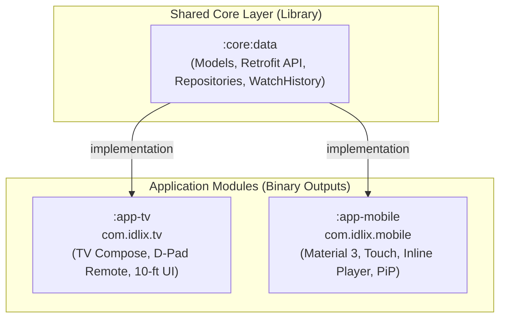

> **ARCHIVED — rencana ini sudah dilaksanakan (multi-module `:core:data` + `:app-tv` + `:app-mobile` selesai).**
> Disimpan sebagai arsip arsitektur. Koreksi: tidak ada lagi layanan scraper/proxy self-hosted — sumber katalog
> adalah resolver redirect-follow `https://idlix.net/` di `core/data`, dan SubDL key via `local.properties`/env.

# Arsitektur Multi-Module: Penyatuan Idlix TV & Idlix Mobile dalam Satu Project

Dokumen ini merinci rencana transformasi arsitektur dari *Single Module* (`:app`) menjadi **Multi-Module Project** yang menampung aplikasi **Android TV** dan **Android Mobile** secara berdampingan tanpa saling mengganggu, dengan berbagi logika data (*shared core*).

---

## 1. Mengapa Multi-Module?

1. **Zero Code Duplication**: Logika koneksi API (`ApiClient` di `app/src/main/java/com/idlix/tv/data/api/ApiClient.kt`, `IdlixApiService` di `app/src/main/java/com/idlix/tv/data/api/IdlixApiService.kt`), data model (`Movie` di `app/src/main/java/com/idlix/tv/data/model/Movie.kt`, `Series` di `app/src/main/java/com/idlix/tv/data/model/Series.kt`, `PlayInfo` di `app/src/main/java/com/idlix/tv/data/model/PlayInfo.kt`), deserializer, dan repository dikelola di satu tempat.
2. **Isolasi Dependensi UI**:
   - Modul TV menggunakan library `androidx.tv:tv-material` & `tv-foundation`.
   - Modul Mobile menggunakan library `androidx.compose.material3:material3`.
   - Keduanya tidak akan saling tumpang tindih (*dependency conflict*).
3. **Build Target Independen**:
   - `./gradlew :app-tv:assembleRelease` -> Menghasilkan APK Android TV (`com.idlix.tv`) untuk Google TV Play Store.
   - `./gradlew :app-mobile:assembleRelease` -> Menghasilkan APK Smartphone/Tablet (`com.idlix.mobile`) untuk Mobile Play Store.
4. **Maintenance Satu Pintu**: Update scraping/streaming API langsung berefek ke TV dan Mobile sekaligus.

---

## 2. Diagram Arsitektur Target



---

## 3. Rincian Modul & Tanggung Jawab

### A. Modul `:core:data` (Android Library)
* **Plugin**: `com.android.library`, `org.jetbrains.kotlin.android`, `kotlinx.serialization`
* **Dependensi UI**: **Tidak ada** (murni data, network, & caching).
* **Komponen yang dipindahkan ke modul ini**:
  - `data/model/*` (`Movie.kt`, `Series.kt`, `PlayInfo.kt`, `Subdl.kt`, `FlexibleSerializers.kt`, dll).
  - `data/api/*` (`ApiClient.kt`, `IdlixApiService.kt`, `MajorplayApiService.kt`).
  - `data/repository/*` (`IdlixRepository.kt`, `SubdlRepository.kt`).
  - `data/local/*` (`WatchHistoryStore.kt`).

### B. Modul `:app-tv` (Android Application)
* **Plugin**: `com.android.application`, `org.jetbrains.kotlin.plugin.compose`
* **Application ID**: `com.idlix.tv`
* **Dependensi**:
  - `implementation(project(":core:data"))`
  - `androidx.tv.foundation`, `androidx.tv.material`
  - Media3 (ExoPlayer + HLS)
* **UI**: 10-foot UI, D-Pad focus handling, `TvNavDrawer`, `TvHeroBillboard`, fixed landscape.

### C. Modul `:app-mobile` (Android Application)
* **Plugin**: `com.android.application`, `org.jetbrains.kotlin.plugin.compose`
* **Application ID**: `com.idlix.mobile`
* **Dependensi**:
  - `implementation(project(":core:data"))`
  - `androidx.compose.material3:material3`
  - Media3 (ExoPlayer + HLS)
  - Coil Compose
* **UI**:
  - Touch-first (Bottom Navigation Bar, Swipe, Pull-to-refresh).
  - **Inline Player (16:9) ke Fullscreen Expand** dengan `BackHandler`.
  - **Picture-in-Picture (PiP)**.
  - Double-tap seek (+/-10 detik), vertical drag brightness/volume.

---

## 4. Penjabaran Rinci Fase-Fase Implementasi

Berikut adalah breakdown tahapan eksekusi secara mendalam dari awal hingga rilis siap pakai:

```mermaid
gantt
    title Roadmap Migrasi Multi-Module & Porting Mobile
    dateFormat  YYYY-MM-DD
    section Fase 1: Shared Core
    Ekstraksi Modul :core:data       :done, f1, 2026-10-24, 1d
    Verifikasi Compile :core:data     :done, f1b, after f1, 1d
    section Fase 2: TV Refactor
    Rename :app ke :app-tv           :active, f2, after f1b, 1d
    Link :app-tv ke :core:data       :active, f2b, after f2, 1d
    Verifikasi APK TV Jalan          :f2c, after f2b, 1d
    section Fase 3: Inisialisasi Mobile
    Setup :app-mobile & Manifest     :f3, after f2c, 1d
    Setup Material 3 Theme & Colors  :f3b, after f3, 1d
    section Fase 4: Navigasi Mobile
    BottomBar & Scaffold             :f4, after f3b, 1d
    Navigation Graph Setup           :f4b, after f4, 1d
    section Fase 5: Mobile Screens
    Home (Banner Pager + Swimlanes)  :f5, after f4b, 2d
    Movies & Series (Grid + Filters) :f5b, after f5, 2d
    Search & History Screens         :f5c, after f5b, 1d
    section Fase 6: Mobile Player
    Inline Player di DetailScreen    :f6, after f5c, 2d
    Fullscreen & BackHandler         :f6b, after f6, 1d
    Touch Gestures (Seek & Volume)   :f6c, after f6b, 1d
    Picture-in-Picture (PiP)         :f6d, after f6c, 1d
    Subtitle Picker BottomSheet      :f6e, after f6d, 1d
    section Fase 7: QA & Rilis
    Testing Multi-device & R8 Build  :f7, after f6e, 2d
```

### 🔹 FASE 1: Ekstraksi Shared Data Layer (`:core:data`)
**Tujuan**: Memisahkan semua logika data dan networking dari modul TV agar dapat dikonsumsi bersama oleh TV dan Mobile.

* **Sub-Tugas 1.1**: Daftarkan plugin `com.android.library` di `gradle/libs.versions.toml`.
* **Sub-Tugas 1.2**: Buat direktori `core/data` dan file `core/data/build.gradle.kts`.
  - Tetapkan `namespace = "com.idlix.core.data"`.
  - Pasang dependencies: Retrofit, KotlinX Serialization, OkHttp, Coroutines.
* **Sub-Tugas 1.3**: Pindahkan file-file berikut dari modul aplikasi ke `core/data/src/main/java/`:
  - `data/model/*` (`Movie.kt`, `Series.kt`, `PlayInfo.kt`, `Subdl.kt`, `FlexibleSerializers.kt`, `WatchHistoryItem.kt`).
  - `data/api/*` (`ApiClient.kt`, `IdlixApiService.kt`, `MajorplayApiService.kt`).
  - `data/repository/*` (`IdlixRepository.kt`, `SubdlRepository.kt`).
  - `data/local/*` (`WatchHistoryStore.kt`).
* **Sub-Tugas 1.4**: Daftarkan `:core:data` di `settings.gradle.kts` (`include(":core:data")`).
* **Kriteria Selesai (DoD)**: Perintah `./gradlew :core:data:assemble` berhasil tanpa error.

---

### 🔹 FASE 2: Refactor & Stabilisasi Modul TV (`:app` -> `:app-tv`)
**Tujuan**: Menghubungkan aplikasi TV ke modul shared data tanpa mengubah fungsionalitas dan tampilan TV yang sudah ada.

* **Sub-Tugas 2.1**: Ubah nama folder `app` menjadi `app-tv` dan sesuaikan `settings.gradle.kts`:
  ```kotlin
  include(":app-tv")
  ```
* **Sub-Tugas 2.2**: Bersihkan folder `app-tv/src/main/java/com/idlix/tv/data/` (karena isinya sudah berada di `:core:data`).
* **Sub-Tugas 2.3**: Tambahkan dependensi di `app-tv/build.gradle.kts`:
  ```kotlin
  implementation(project(":core:data"))
  ```
* **Sub-Tugas 2.4**: Perbarui import di seluruh UI TV (`HomeScreen`, `DetailScreen`, `PlayerScreen`, dll) jika path package disesuaikan ke `com.idlix.core.data.*`.
* **Sub-Tugas 2.5**: Uji build TV secara penuh:
  ```bash
  ./gradlew :app-tv:assembleDebug
  ```
* **Kriteria Selesai (DoD)**: Aplikasi Android TV berjalan normal pada emulator/device TV, navigasi D-Pad dan pemutaran video tetap 100% berfungsi seperti semula.

---

### 🔹 FASE 3: Inisialisasi Modul Mobile (`:app-mobile`) & Setup Dasar
**Tujuan**: Membangun fondasi aplikasi mobile modern berbasis Material 3 dan Edge-to-Edge display.

* **Sub-Tugas 3.1**: Daftarkan `:app-mobile` di `settings.gradle.kts` dan buat direktori `app-mobile/`.
* **Sub-Tugas 3.2**: Buat `app-mobile/build.gradle.kts`:
  - `applicationId = "com.idlix.mobile"`
  - Pasang library: Compose BOM, Compose Material 3, Navigation Compose, Media3 ExoPlayer, Coil Compose, dan `project(":core:data")`.
  - **Penting**: Tidak memasukkan library `androidx.tv.*`.
* **Sub-Tugas 3.3**: Konfigurasi `app-mobile/src/main/AndroidManifest.xml`:
  - `android.hardware.touchscreen` required `true`.
  - Hapus Leanback category / TV banners.
  - Aktifkan flag `android:supportsPictureInPicture="true"`.
  - Handle orientasi: `configChanges="orientation|screenSize|screenLayout|smallestScreenSize|keyboardHidden|keyboard"`.
* **Sub-Tugas 3.4**: Setup `IdlixMobileApp.kt` dan `MainActivity.kt`:
  - Panggil `enableEdgeToEdge()` untuk tampilan layar penuh modern tanpa black bar di status bar.
* **Sub-Tugas 3.5**: Setup Desain Sistem Material 3 (`ui/theme/`):
  - Palet warna dark mode streaming (Background `#0E0E12`, Surface `#18181E`, Primary Merah Idlix `#E50914`, Accent `#00ADB5`).
* **Kriteria Selesai (DoD)**: Modul `:app-mobile` dapat di-build dan menampilkan layar kosong bertema Idlix di smartphone.

---

### 🔹 FASE 4: Navigasi Mobile & Shell Layout
**Tujuan**: Menyediakan kerangka navigasi bawah (Bottom Navigation) yang intuitif untuk penggunaan satu tangan.

* **Sub-Tugas 4.1**: Definisikan rute navigasi mobile di `ui/navigation/MobileScreen.kt`:
  - `Home` (`"home"`)
  - `Movies` (`"movies"`)
  - `Series` (`"series"`)
  - `Search` (`"search"`)
  - `History` (`"history"`)
  - `Detail` (`"detail/{contentType}/{slug}"`)
* **Sub-Tugas 4.2**: Buat `MainScaffold`:
  - `NavigationBar` di bagian bawah dengan 5 item (Beranda, Film, Serial, Cari, Riwayat).
  - Menyembunyikan BottomBar saat membuka layar Detail / Player Fullscreen.
  - Menjaga state masing-masing tab (`saveState = true`, `restoreState = true`).
* **Sub-Tugas 4.3**: Integrasi Window Insets (`WindowInsets.navigationBars`, `WindowInsets.statusBars`) agar UI tidak terpotong tombol navigasi perangkat.
* **Kriteria Selesai (DoD)**: Transisi antar-tab BottomBar berjalan mulus tanpa lag.

---

### 🔹 FASE 5: Pembuatan Layar Konten Mobile (Screens)
**Tujuan**: Mengadaptasi layout konten TV agar ramah sentuhan, mendukung scroll vertikal/horizontal cepat, dan responsif.

* **Sub-Tugas 5.1: Home Screen**:
  - Ganti billboard TV dengan `HorizontalPager` banner (swipeable dengan dot indicators).
  - Deretan "Lanjutkan Menonton" horizontal card dengan progress bar tontonan.
  - Swimlanes kategori film & serial menggunakan `LazyRow` berkecepatan tinggi dengan poster rasio 2:3.
  - Implementasikan gesture **Pull-to-Refresh** (`PullToRefreshBox`).
* **Sub-Tugas 5.2: Movies & Series Screens**:
  - Grid film menggunakan `LazyVerticalGrid` dengan `GridCells.Fixed(3)` pada smartphone dan `Fixed(5)` pada tablet.
  - Deretan filter chips horizontal di atas: pilihan Genre (Action, Drama, Comedy, dll) dan Urutan (Popular, Latest, Top Rated).
  - Pagination otomatis saat user menggulir mendekati batas bawah halaman.
* **Sub-Tugas 5.3: Search Screen**:
  - `SearchBar` Material 3 di bagian atas dengan tombol pembersih (clear) dan keyboard autofocus.
  - Debounce input ketikan 400ms untuk mencegah spam request API.
  - Tampilan hasil dalam bentuk grid poster 3 kolom.
* **Sub-Tugas 5.4: History / Library Screen**:
  - Daftar riwayat tontonan tersimpan dari `WatchHistoryStore`.
  - Tombol hapus item riwayat individual atau bersihkan semua riwayat.
* **Kriteria Selesai (DoD)**: Pengguna dapat menelusuri katalog, menyaring genre, mencari judul, dan melihat riwayat secara lancar via sentuhan.

---

### 🔹 FASE 6: Mobile Player Experience (Inline, Fullscreen, Gestures & PiP)
**Tujuan**: Menghadirkan pemutar video streaming kelas atas khusus ponsel.

* **Sub-Tugas 6.1: Detail Screen dengan Inline Player (16:9)**:
  - Saat judul diklik, pengguna diarahkan ke `DetailScreen`.
  - Di bagian atas layar langsung terdapat **Inline Player** (rasio 16:9, tinggi ~220–250dp) yang otomatis memulai streaming.
  - Di bawah inline player terdapat informasi metadata lengkap: Judul, Rating, Genre, Sinopsis, Tombol Simpan/Bagikan.
  - Untuk serial: Selector Season (Dropdown / TabRow) dan daftar Episode vertikal yang dapat diklik untuk langsung mengganti stream video tanpa berpindah layar.
* **Sub-Tugas 6.2: Transisi Layar Penuh (Fullscreen Expansion)**:
  - Tombol fullscreen di pojok kanan bawah overlay player.
  - Mengubah orientasi activity menjadi `ActivityInfo.SCREEN_ORIENTATION_SENSOR_LANDSCAPE`.
  - Masuk ke *Immersive Mode* (menyembunyikan status bar dan bar navigasi sistem).
* **Sub-Tugas 6.3: Intercept Tombol Back (`BackHandler`)**:
  - Jika video sedang dalam mode Fullscreen dan tombol Back ditekan: **player mengecil kembali ke mode Inline Portrait**, tidak langsung menutup layar.
  - Jika video sedang dalam mode Inline dan tombol Back ditekan: pengguna kembali ke layar sebelumnya (Home/Search).
* **Sub-Tugas 6.4: Touch Gestures Controller**:
  - **Double-Tap**: Sisi kiri untuk rewind 10s, sisi kanan untuk forward 10s disertai animasi ripple angka "+10 / -10".
  - **Vertical Swipe**: Sisi kiri layar untuk mengatur Brightness (kecerahan), sisi kanan untuk Volume suara.
  - **Horizontal Swipe**: Scrubbing posisi timeline video dengan preview waktu.
  - **Single Tap**: Toggle visibilitas overlay kontrol player (auto-hide setelah 4 detik).
* **Sub-Tugas 6.5: Picture-in-Picture (PiP)**:
  - Override method `onUserLeaveHint()` di `MainActivity.kt`.
  - Saat video sedang diputar (baik di inline maupun fullscreen) dan user menekan tombol Home atau swipe ke app switcher, aplikasi otomatis mengecil menjadi jendela floating PiP.
  - Kontrol UI otomatis disembunyikan saat masuk ke PiP.
* **Sub-Tugas 6.6: Subtitle & Audio Track Selector**:
  - Tombol ikon Subtitle di kontrol player yang memunculkan `ModalBottomSheet`.
  - Menampilkan daftar trek subtitle bawaan stream serta daftar subtitle Indonesia/Inggris dari repositori Subdl.
* **Sub-Tugas 6.7: Auto Next Episode**:
  - Menampilkan dialog / banner overlay 30 detik sebelum episode berakhir untuk melanjutkan ke episode berikutnya secara otomatis.
* **Kriteria Selesai (DoD)**: Pemutar video mendukung pengalaman inline browsing, fullscreen immersive, kontrol gestur swipe/tap, PiP saat minimize, dan pemilihan subtitle yang akurat.

---

### 🔹 FASE 7: QA, Optimasi Build & Rilis Independen
**Tujuan**: Memastikan kestabilan aplikasi di berbagai jenis smartphone Android sebelum rilis.

* **Sub-Tugas 7.1: Pengujian Adaptabilitas Layar**:
  - Uji tampilan pada smartphone ber-notch (punch hole camera) menggunakan `WindowInsets.displayCutout`.
  - Uji tampilan pada tablet / foldable screen (multi-pane layout).
* **Sub-Tugas 7.2: Efisiensi Baterai & Lifecycle**:
  - Memastikan `ExoPlayer` di-pause pada `onPause()` dan di-release dengan tepat pada `onDestroy()` untuk menghindari kebocoran memori (*memory leak*).
* **Sub-Tugas 7.3: Konfigurasi Proguard & R8**:
  - Konfigurasi aturan Proguard untuk Retrofit dan KotlinX Serialization agar rilis APK berukuran kecil (<15 MB) dan tidak crash akibat obfusikasi nama model DTO.
* **Sub-Tugas 7.4: Build Pipeline**:
  - Verifikasi bahwa kedua modul dapat di-build secara terpisah:
    ```bash
    ./gradlew :app-tv:assembleRelease
    ./gradlew :app-mobile:assembleRelease
    ```
* **Kriteria Selesai (DoD)**: Kedua APK berhasil digenerate, siap ditandatangani (*signed*), dan siap didistribusikan ke pengguna.

---

## 5. Konfigurasi Gradle Detail

### 1. `gradle/libs.versions.toml`
Tambahkan plugin library Android:
```toml
[plugins]
android-application = { id = "com.android.application", version.ref = "agp" }
android-library = { id = "com.android.library", version.ref = "agp" }
kotlin-android = { id = "org.jetbrains.kotlin.android", version.ref = "kotlin" }
kotlin-compose = { id = "org.jetbrains.kotlin.plugin.compose", version.ref = "kotlin" }
kotlin-serialization = { id = "org.jetbrains.kotlin.plugin.serialization", version.ref = "kotlin" }
```

### 2. `settings.gradle.kts`
```kotlin
rootProject.name = "idlix-tv"

include(":core:data")
include(":app-tv")
include(":app-mobile")
```

### 3. `core/data/build.gradle.kts`
```kotlin
plugins {
    alias(libs.plugins.android.library)
    alias(libs.plugins.kotlin.android)
    alias(libs.plugins.kotlin.serialization)
}

android {
    namespace = "com.idlix.core.data"
    compileSdk = 35

    defaultConfig {
        minSdk = 24
        
        // Sumber katalog: resolver redirect-follow https://idlix.net/ di runtime (tanpa URL backend statis).
        // SubDL key (third-party, api.subdl.com) via local.properties/env — tanpa default bawaan.
    }

    compileOptions {
        sourceCompatibility = JavaVersion.VERSION_21
        targetCompatibility = JavaVersion.VERSION_21
    }

    buildFeatures {
        buildConfig = true
    }
}

dependencies {
    implementation(libs.androidx.core.ktx)
    implementation(libs.retrofit)
    implementation(libs.retrofit.kotlinx.serialization)
    implementation(libs.okhttp)
    implementation(libs.okhttp.logging)
    implementation(libs.kotlinx.serialization.json)
    implementation(libs.kotlinx.coroutines.android)
}
```

### 4. `app-tv/build.gradle.kts`
```kotlin
plugins {
    alias(libs.plugins.android.application)
    alias(libs.plugins.kotlin.android)
    alias(libs.plugins.kotlin.compose)
}

android {
    namespace = "com.idlix.tv"
    compileSdk = 35
    // ... konfigurasi signing & release TV ...
}

dependencies {
    implementation(project(":core:data"))
    
    // TV UI
    implementation(libs.androidx.tv.foundation)
    implementation(libs.androidx.tv.material)
    
    // Player
    implementation(libs.androidx.media3.exoplayer)
    implementation(libs.androidx.media3.exoplayer.hls)
    implementation(libs.androidx.media3.ui)
    
    // Coil & Navigation
    implementation(libs.coil.compose)
    implementation(libs.androidx.navigation.compose)
}
```

### 5. `app-mobile/build.gradle.kts`
```kotlin
plugins {
    alias(libs.plugins.android.application)
    alias(libs.plugins.kotlin.android)
    alias(libs.plugins.kotlin.compose)
}

android {
    namespace = "com.idlix.mobile"
    compileSdk = 35

    defaultConfig {
        applicationId = "com.idlix.mobile"
        minSdk = 26
        targetSdk = 35
        versionCode = 1
        versionName = "1.0.0"
    }
}

dependencies {
    implementation(project(":core:data"))

    // Mobile Compose Material 3
    implementation(platform(libs.androidx.compose.bom))
    implementation(libs.androidx.compose.ui)
    implementation(libs.androidx.compose.material3)
    implementation(libs.androidx.compose.material.icons)
    
    // Player
    implementation(libs.androidx.media3.exoplayer)
    implementation(libs.androidx.media3.exoplayer.hls)
    implementation(libs.androidx.media3.ui)
    
    // Coil & Navigation
    implementation(libs.coil.compose)
    implementation(libs.androidx.navigation.compose)
}
```

---

## 6. Contoh Panduan Implementasi Komponen Utama

### A. Konfigurasi `AndroidManifest.xml` (Mobile)
```xml
<?xml version="1.0" encoding="utf-8"?>
<manifest xmlns:android="http://schemas.android.com/apk/res/android">

    <uses-permission android:name="android.permission.INTERNET" />
    <uses-permission android:name="android.permission.ACCESS_NETWORK_STATE" />
    <uses-permission android:name="android.permission.WAKE_LOCK" />

    <application
        android:name=".IdlixApp"
        android:allowBackup="true"
        android:icon="@mipmap/ic_launcher"
        android:label="@string/app_name"
        android:supportsRtl="true"
        android:theme="@style/Theme.IdlixMobile"
        android:usesCleartextTraffic="true">

        <activity
            android:name=".MainActivity"
            android:exported="true"
            android:supportsPictureInPicture="true"
            android:configChanges="screenSize|smallestScreenSize|screenLayout|orientation|keyboardHidden|keyboard"
            android:windowSoftInputMode="adjustResize">
            <intent-filter>
                <action android:name="android.intent.action.MAIN" />
                <category android:name="android.intent.category.LAUNCHER" />
            </intent-filter>
        </activity>
    </application>
</manifest>
```

### B. Pola Inline Player ke Fullscreen & BackHandler
```kotlin
@Composable
fun VideoPlayerContainer(
    isFullscreen: Boolean,
    onToggleFullscreen: (Boolean) -> Unit,
    modifier: Modifier = Modifier,
    contentDetails: @Composable () -> Unit
) {
    val activity = LocalContext.current as? Activity

    // Intercept back button saat fullscreen agar kembali ke inline player
    BackHandler(enabled = isFullscreen) {
        onToggleFullscreen(false)
        activity?.requestedOrientation = ActivityInfo.SCREEN_ORIENTATION_PORTRAIT
    }

    if (isFullscreen) {
        // Layar Penuh (Landscape Immersive)
        Box(modifier = Modifier.fillMaxSize()) {
            ExoPlayerView(modifier = Modifier.fillMaxSize())
        }
    } else {
        // Mode Inline (Portrait): Player 16:9 di atas, detail konten di bawah
        Column(modifier = modifier.fillMaxSize()) {
            Box(
                modifier = Modifier
                    .fillMaxWidth()
                    .aspectRatio(16f / 9f)
            ) {
                ExoPlayerView(modifier = Modifier.fillMaxSize())
                // Tombol Fullscreen di pojok overlay player
                IconButton(
                    onClick = {
                        onToggleFullscreen(true)
                        activity?.requestedOrientation = ActivityInfo.SCREEN_ORIENTATION_SENSOR_LANDSCAPE
                    },
                    modifier = Modifier.align(Alignment.BottomEnd)
                ) {
                    Icon(Icons.Default.Fullscreen, contentDescription = "Fullscreen")
                }
            }
            // Detail konten (Sinopsis, Episode List, Rekomendasi)
            contentDetails()
        }
    }
}
```

### C. Pola Double-Tap Seek & Touch Control (Player)
```kotlin
// Sketsa logic gesture pada Box overlay Player
Modifier.pointerInput(Unit) {
    detectTapGestures(
        onDoubleTap = { offset ->
            val screenWidth = size.width
            if (offset.x < screenWidth / 2) {
                player.seekTo((player.currentPosition - 10_000).coerceAtLeast(0))
            } else {
                player.seekTo((player.currentPosition + 10_000).coerceAtMost(player.duration))
            }
        },
        onTap = {
            isControlsVisible = !isControlsVisible
        }
    )
}
```

### D. Implementasi Picture-in-Picture (PiP)
```kotlin
// Di dalam MainActivity.kt
override fun onUserLeaveHint() {
    super.onUserLeaveHint()
    if (isPlayingVideo) {
        val params = PictureInPictureParams.Builder()
            .setAspectRatio(Rational(16, 9))
            .build()
        enterPictureInPictureMode(params)
    }
}
```

---

## 7. Checklist Verifikasi Sebelum Rilis

- [ ] Plugin `com.android.library` terdaftar di `libs.versions.toml`.
- [ ] Modul `:core:data` berhasil di-compile secara independen (`./gradlew :core:data:assemble`).
- [ ] Modul `:app-tv` berhasil di-compile tanpa error import model/API (`./gradlew :app-tv:assembleDebug`).
- [ ] Modul `:app-mobile` dibuat dengan tema Material 3 dan Bottom Navigation Bar.
- [ ] Pemutar mobile mendukung transisi lancar dari inline ke fullscreen dan PiP.
- [ ] APK TV dan APK Mobile dapat dibuild secara terpisah tanpa saling mengganggu.
